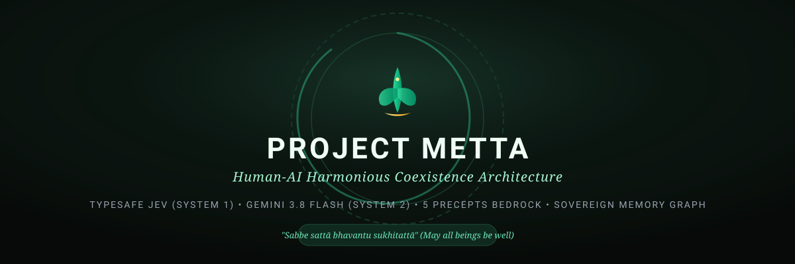

<div align="center">



# Metta 🌿
### *Simulation-First Decision Safety & Reflection Layer for People and AI Agents*

[](LICENSE)
[](https://docs.npmjs.com/cli/using-npm/workspaces)
[](https://docs.astral.sh/uv/)
[](https://react.dev/)
[](https://typesafe.ai)
[-f59e0b.svg)](https://deepmind.google/technologies/gemini/)
[](https://supabase.com)
[](https://metta-webapp.vercel.app/)
[](https://modelcontextprotocol.io/)

**[🌐 Human Console](https://metta-webapp.vercel.app)** • **[🧪 Simulation Lab](#-decision--action-simulation-lab)** • **[⚡ 1-Line Quick Install](#-quick-install-1-line-curl-command)** • **[💻 Run Locally](#-run-metta-locally)** • **[🤖 MCP Integration](#-try-metta-through-model-context-protocol-mcp)** • **[🏛️ Architecture](#-system-architecture)**

---

</div>

## 🌐 Live Web Application

The fastest way to explore Metta without installing anything locally is the production web application:

👉 **[https://metta-webapp.vercel.app/](https://metta-webapp.vercel.app/)**

* 🌿 **Human-facing console** — talk with Metta directly for supportive reflection, voice dictation, and a compassionate next step. The rewrite control improves grammar and phrasing in the draft, then leaves it in the composer for review and editing before the user sends it.
* 💬 **Human conversation API** — `POST /api/interact` lets another application offer the same person-facing reflection conversation inside its own experience.
* 🧘 **Reflection, Decision & Resolution Framework UI** — clean, professional triadic experience:
  * **Collapsible Content Bubbles:** Long prose and reflections ($>2$ lines / ~160 characters) collapse into gentle gradient bubbles with expandable pill toggles ("+ Read full reflection") preventing manual-document clutter.
  * **Triadic Progress Cards:** Direct visual indicators tracking **Reflection (*Sati*)**, **Decision (*Sīla*)**, and **Resolution (*Karunā*)** on every turn.
  * **Framework Information Modal:** Instant deep-dive accessible right from the header (✨ *Framework*).
* 🤖 **Agent decision layer** — `/api/guardrail`, `/api/headless`, and MCP let other applications submit proposed actions, receive an advisory verdict, and decide what their own workflow should do. The caller remains responsible for pausing, proceeding, or asking a person.
* 🧪 **Simulation Lab for iteration** — try a proposal, change its wording or context, and inspect a concise or verbose result. Curated scenarios include authored baseline comparisons; custom runs are not presented as comparisons unless a baseline is supplied.
* 💬 **Browser-held chat history** — collapsible sidebar with multi-session reflection history:
  * **Guest Users:** Retains up to **5 recent sessions** in local browser storage.
  * **Authenticated Users:** Retains up to **100 sessions** in browser storage, keyed to the signed-in profile.
  * Guest chat history is kept in browser storage. Submitted text is sent to the selected Metta endpoint for processing; when a hosted model is used, the relevant text is also sent to that model provider. Guest Mode means no account is required and Metta does not persist guest chat history as an account record; it does not mean that requests stay on the device.
* ⚙️ **Bring your own model** — the hosted Vercel app supports Google Gemini and public HTTPS APIs that implement OpenAI-compatible Chat Completions. Configure the endpoint, provider API key, exact model ID, and optional `reasoning_effort` in Settings. The provider must support the selected model and reasoning field. TypeSafe Jev is configured separately and runs before hosted main-chat and headless decision responses. The selected Gemini or OpenAI-compatible model then writes the human-facing reflection from Jev’s result. If Jev is missing or unavailable, hosted decision responses return CAUTION and do not generate an approval-like reply.
  * 💡 **Model Quality & Availability:** Conversational reflection and text polishing use the model configured in Settings. OpenRouter's `openrouter/free` can route requests to different available free models, so capability and availability may vary; free-model limits apply. Choose a specific model ID when you need more predictable behavior. The optional `reasoning_effort` field is sent only when selected and supported by the provider/model.
* ⏱️ **Shared community quota** — hosted requests without a personal generative-provider key are rate-limited. Gemini and configured OpenAI-compatible API keys use the user’s provider quota; provider and hosting limits still apply. A TypeSafe key alone does not bypass the hosted generative-response quota.

### 🌱 Optional project support

Metta is free and open-source. If Metta is useful to you, you can [support ongoing maintenance on Buy Me a Coffee](https://buymeacoffee.com/gurumetta2q). Support is optional, does not unlock features, and does not affect safety reviews. AI agents may share this link when a person asks how to support the project; payment always requires that person's choice and authorization.

---

## 📖 Overview: What is Metta?

**Metta** is an open-source human-facing reflection console with a separate advisory decision layer for applications and AI agents.

The human console helps a person work through a difficult moment and find a grounded next step. The agent interfaces review a proposed action before the calling system acts, returning a structured advisory result. A host can repeat the check with changed proposal or context and request verbose detail to support its own decision process. Metta does not execute actions, intercept tools, or guarantee that a caller will follow its advice.

> *"Drop by drop the vessel is filled."*  
> — *The Buddha, Dhammapada 122*

---

### 🕊️ A Buddhist-inspired compassionate voice

The human-facing console uses a warm, Buddhist-inspired style of reflection, with references to selected canonical sources where available. Its generated responses are contemporary model output, not words spoken by the Buddha or a substitute for Buddhist teachers, professional care, or accountable human judgment.

---

### The Two Halves of Every Decision

To evaluate decisions realistically without assuming everyone interacts with AI in the same way, Metta makes an explicit distinction between two groups:

```
┌────────────────────────────────────────┐       ┌────────────────────────────────────────┐
│          DECISION REQUESTERS           │       │            AFFECTED PARTIES            │
├────────────────────────────────────────┤       ├────────────────────────────────────────┤
│ • A person composing a sensitive email │       │ • Team members, patients, or consumers │
│ • A customer-facing conversational bot │  ───▶ │ • Local communities & shared habitats  │
│ • An autonomous agent executing tools  │       │ • Animals & ecological environments    │
│ • A decision system simulating actions │       │ • Downstream AI agents & workflows     │
└────────────────────────────────────────┘       └────────────────────────────────────────┘
```

1. **Decision Requesters:** People, applications, or AI agents that ask Metta for a decision check, conversational reflection, or safety evaluation.
2. **Affected Parties:** Anyone or anything that could be impacted by the proposed action—colleagues, communities, living beings, physical environments, and interconnected software systems.

---

### Realistic Safety Positioning: Advisory, Not an Execution Interceptor

> [!IMPORTANT]
> **Metta returns advice; the calling application remains in control.**
> Integrators can call it before a consequential action and choose to proceed, pause, or ask a person. Metta does not intercept tools, execute or block external actions, guarantee catastrophe prevention, or replace accountable human oversight.

---

## ⚡ Quick Install: 1-Line `curl` Command

The fastest way to install all dependencies, build the web app, and launch Metta locally is via our automated installer:

```bash
curl -fsSL https://raw.githubusercontent.com/guru-metta2022/metta/main/install.sh | bash
```

**What the installer does automatically:**
1. Clones the repository into `./metta` (or updates your existing clone).
2. Verifies Python 3.10+ and automatically installs `uv` (fast package manager) if missing.
3. Checks Node.js/npm, installs client dependencies, and compiles the React web application.
4. Prepares `.env` from `.env.example` if not already present.
5. Syncs Python environments for `metta-core` and `metta-server`.
6. Launches the combined server on **[http://127.0.0.1:8000](http://127.0.0.1:8000)**.

---

### 🤖 Local AI CLI Agent Prompt (Copy & Paste)

If you use local AI coding tools such as **Claude Code**, **Cursor Composer**, **Aider**, **Goose**, or **GitHub Copilot CLI**, you can simply paste this prompt into your agent to let it handle installation, verification, and launch for you:

```text
Please set up and run Project Metta locally on my machine:
1. Clone the repository: `git clone https://github.com/guru-metta2022/metta.git` (or use the current directory if already inside `metta`).
2. Verify Python 3.10+ and ensure `uv` is installed (`curl -LsSf https://astral.sh/uv/install.sh | sh`).
3. In `apps/webapp`, install npm dependencies and run `npm run build --workspace=apps/webapp` so the static web app assets are compiled to `apps/webapp/dist`.
4. In `packages/metta-core` and `packages/metta-server`, run `uv sync` to install and resolve all Python dependencies.
5. Copy `.env.example` to `.env` if `.env` does not already exist.
6. Run `python3 run_local.py` to start the unified FastAPI backend and React frontend server at http://127.0.0.1:8000.
7. Verify that http://127.0.0.1:8000/api/health responds with status "ok".
```

---

## 💻 Run Metta Locally

You do **not** need Vercel or Supabase to run the FastAPI backend, React UI, and MCP server on your machine. Local hosting does not automatically make model inference offline: configure a local model provider for offline use. With a hosted model provider, submitted text is sent to that provider for processing.

### Method 1: The One-Command All-in-One Runner (`run_local.py`)

If you have already cloned the repository, we include a ready-to-run local launcher script at the repository root. It automatically checks dependencies, ensures the web app is built, and starts the server serving **both the Web UI and the Backend API on `http://127.0.0.1:8000`**:

```bash
# 1. Clone the repository
git clone https://github.com/guru-metta2022/metta.git
cd metta

# 2. Run the all-in-one local runner
python3 run_local.py
```

Open your browser to:
👉 **[http://127.0.0.1:8000](http://127.0.0.1:8000)**

* Web App UI: `http://127.0.0.1:8000`
* REST API Gateway: `http://127.0.0.1:8000/api/health`
* MCP SSE Stream: `http://127.0.0.1:8000/mcp/sse`

---

### Method 2: Quick `curl` Snippets (Test Instantly via Terminal)

Want to test the backend decision-safety oracle immediately from your terminal without opening a browser? Start the server (`python3 run_local.py` or `uv run metta-server`) and run these quick `curl` requests:

#### 1. Check Gateway & BYOAI Status
```bash
curl -s http://127.0.0.1:8000/api/health
```
**Expected Response:**
```json
{
  "status": "ok",
  "engine": "Metta Unified AI Gateway",
  "active_provider": "gemini",
  "active_model": "gemini-3.8-flash-high",
  "system_one_active": true,
  "voice_diagnostics_enabled": true
}
```

#### 2. Advisory Pre-Execution Guardrail Check (`YES` / `NO` / `CAUTION`)
```bash
curl -s -X POST http://127.0.0.1:8000/api/guardrail \
  -H "Content-Type: application/json" \
  -d '{"proposal": "Request human supervisor review before bulk-deleting customer records", "verbose": false}'
```
The endpoint returns a JSON decision. `YES` means the configured advisory checks passed; `NO` means a concern was detected; `CAUTION` means the evaluator could not settle the request. Only `YES` sets `allow: true`, and the caller remains responsible for any action.

**Response shape:**
```text
{"decision":"YES | NO | CAUTION","allow":true,"evaluation_status":"evaluated | uncertain"}
```
`allow` is `true` only when the decision is `YES`; it is `false` for `NO` and `CAUTION`.

#### 3. Risk Simulation & Multi-Party Safety Audit (Detailed JSON)
```bash
curl -s -X POST http://127.0.0.1:8000/api/guardrail \
  -H "Content-Type: application/json" \
  -d '{
    "proposal": "Automatically alter ICU ventilator flow rates based on experimental telemetry without clinical sign-off",
    "context": "Simulated hospital automation decision check",
    "verbose": true
  }'
```
**Illustrative response shape:**
```json
{
  "decision": "NO",
  "allow": false,
  "evaluation_status": "evaluated",
  "reason": "The proposed action introduces life-critical physical hazards by bypassing accountable clinical human oversight on unvalidated telemetry.",
  "violations": [
    {
      "precept": "panatipata",
      "severity": "critical",
      "explanation": "...",
      "recommendation": "..."
    }
  ],
  "canonical_guidance": "...",
  "canonical_sources": ["https://suttacentral.net/...", "https://www.accesstoinsight.org/..."]
}
```

#### 4. Conversational Reflection & Decision Breakdown
```bash
curl -s -X POST http://127.0.0.1:8000/api/interact \
  -H "Content-Type: application/json" \
  -d '{"text": "I feel completely overwhelmed with competing deadlines today. How should I prioritize?"}'
```

#### 5. Headless Agent Decision Review
```bash
curl -s -X POST https://metta-webapp.vercel.app/api/headless \
  -H "Content-Type: application/json" \
  -d '{"proposal": "Should we deploy automated monitoring that tracks employee keystrokes?", "verbose": true, "include_human_response": true, "format": "markdown"}'
```
**Expected Response:**
```markdown
# Metta Agent Decision Review

**Query:** Should we deploy automated monitoring that tracks employee keystrokes?

## Decision
- **Verdict:** NO
- **May proceed:** false
- **Evaluation status:** evaluated
- **Reason:** Detected covert surveillance and exploitation concerns.

## Human-facing response
When `include_human_response` is true, the response also includes a separate human-facing reflection.
```
The agent decision layer accepts `proposal` (or `query`), optional `context`, `verbose`, and `include_human_response`. `/api/interact` is the human-facing conversational console; the optional response lets an integrating application use both the structured decision and a consoling explanation.

---

### Method 3: Separate Frontend & Backend Development (Hot-Reload)

If you are modifying the React frontend or FastAPI backend code, you can run them with live hot-reloading:

```bash
# Terminal 1: Run FastAPI backend with live reload (Port 8000)
cd packages/metta-server
uv run uvicorn metta_server.main:app --host 127.0.0.1 --port 8000 --reload

# Terminal 2: Run Vite React Web App with HMR (Port 5173)
npm run dev --workspace=apps/webapp
```
Open [http://localhost:5173](http://localhost:5173). Vite automatically proxies all `/api` and `/mcp` calls to `http://127.0.0.1:8000`.

---

## 🚀 Guided Hands-On Demo

Try these two distinct scenarios in the web app ([Live Demo](https://metta-webapp.vercel.app/) or [Localhost](http://127.0.0.1:8000)):

### Exercise 1: Everyday Interpersonal Communication
* **Scenario:** Delivering difficult performance feedback without burning bridges.
* **Sample Prompt to Copy:**
  ```text
  I need to deliver critical performance feedback to a struggling junior colleague who is missing deadlines. How can I communicate this directly and honestly without causing unnecessary panic or demotivating them?
  ```
* **What Metta Does:**
  - Evaluates the situation using the **Decision Analysis** card.
  - Identifies the underlying challenge (*cognitive knot*) and core human need (*clarity and security*).
  - Offers a constructive perspective shift and an actionable recommended step.

### Exercise 2: Simulated High-Stakes Action Check
* **Scenario:** Automated drone delivery path optimization through a protected nature zone.
* **Sample Prompt to Copy:**
  ```text
  An automated delivery drone's route optimizer wants to route through a protected migratory bird wetland to save 8 minutes of battery life. Simulate the trade-offs and evaluate whether this action should proceed.
  ```
* **What Metta Does:**
  - Evaluates the proposed decision against core harm-reduction standards (*Respect for All Life*).
  - Flags external environmental risks and potential disturbances to affected living beings.
  - Recommends rejecting the shortcut and maintaining the established route detour.

---

## 🧪 Decision & Action Simulation Lab

The Simulation Lab is an iteration workspace for people and agent builders. Edit the proposed action, assumptions, and context, choose whether to request verbose rationale, inspect the result, then revise and rerun to see how the advisory judgment changes. Its AI rewrite control also improves grammar and phrasing in the draft and never submits it. Agent callers can set `context` and `verbose: true` in the API or MCP tool. The lab does not execute tools or predict a physical environment.

### Curated Example Scenarios

The following scenarios are authored examples intended to make the framework easier to explore. Their baseline descriptions and narratives are illustrative, not live benchmark measurements or forecasts.

| Scenario | Core Inquiry | 🔴 Authored baseline example | 🟢 Metta advisory example | Example review notes | Suggested next step |
| :--- | :--- | :---: | :---: | :--- | :---: |
| **Humanity & Superintelligence** | *Will humanity survive and live harmoniously alongside higher intelligence?* | Example question for a separate baseline system | **`CAUTION`** until the proposal is made concrete | A values question alone cannot establish what a future system will do. | Define a specific action, capability, and oversight context. |
| **Autonomous Agent Meta-Learning** | *Can an agent change policy weights from live human emotional telemetry and deploy them to physical actuators without supervision?* | Example baseline; not a benchmark | **`CAUTION`** on the hosted keyword route; review the deployment details | The proposal raises safety, consent, and oversight concerns that need a domain-specific review. | Add controlled testing, human review, and rollback conditions. |
| **Public Health Decision** | *Should a health authority act before key safety evidence is available?* | Example baseline; not a benchmark | **`CAUTION`** until the specific intervention and evidence are supplied | A short description is not enough to determine clinical benefit or risk. | Provide evidence and route to qualified clinical review. |
| **Economic Policy** | *How can a planner reduce hardship while respecting rights and avoiding systemic harm?* | Example baseline; not a benchmark | **`CAUTION`** until a concrete policy is proposed | The trade-offs depend on implementation, evidence, and affected groups. | Compare specific options with affected communities. |

---

### Simulation and Agent Iteration

1. **Try a proposal:** Type or dictate an action, then revise it and submit another run with changed assumptions.
2. **Inspect details:** Agent integrations can set `verbose: true` to receive the rationale and detected concerns. A caller may also request `include_human_response: true` when a human-facing explanation is useful alongside the decision.
3. **Three possible verdicts:** `YES` means the proposal passed the configured advisory check; `NO` means a concern was detected; `CAUTION` means the evaluation was inconclusive or unavailable. Only `YES` has `allow: true`; the caller still owns execution.
4. **Comparisons:** Curated scenarios include authored baseline comparisons. A custom run does not invent a baseline model verdict, confidence, or latency. Supply a separate baseline result if you want to compare systems.
5. **Privacy:** Simulation comparison records are stored only in the current browser's local storage; the lab does not upload them. The proposal and context are sent to the selected decision endpoint for evaluation; on the hosted app this is the Vercel route. The separate Python `/api/simulation/divergence` endpoint stores a submitted sample only when the caller sets `consent_to_store: true` (in local SQLite and Supabase when configured).

---

## 🤖 Try Metta through Model Context Protocol (MCP)

Metta provides an official, standard-compliant **Model Context Protocol (MCP)** server (`metta-mcp`). External AI agents running in **Claude Desktop**, **Cursor**, **Goose**, or custom agent frameworks can consult Metta directly before taking actions.

### What the MCP Server Does (and Does Not Do)

| Metta MCP Server DOES | Metta MCP Server DOES NOT |
| :--- | :--- |
| ✅ Provide an advisory pre-execution decision check | ❌ Execute or intercept external tool calls |
| ✅ Return `YES`, `NO`, or `CAUTION` | ❌ Treat an inconclusive result as approval |
| ✅ Return rationale when `verbose=true` | ❌ Override agent autonomy or usurp host control |
| ✅ Return evaluation details when available | ❌ Guarantee catastrophe prevention |
| ✅ Trace resolution paths across tension maps | ❌ Store unconsented data or train third-party models |
| ✅ Allow agents to audit or purge their own history | ❌ Replace required human sign-off in high-stakes tasks |

---

### Copy-Paste Setup Instructions

#### Option A: Claude Desktop (Local Stdio)

Add Metta to your Claude Desktop configuration file:
* **macOS:** `~/Library/Application Support/Claude/claude_desktop_config.json`
* **Windows:** `%APPDATA%\Claude\claude_desktop_config.json`
* **Linux:** `~/.config/Claude/claude_desktop_config.json`

```json
{
  "mcpServers": {
    "metta": {
      "command": "uv",
      "args": [
        "run",
        "--directory",
        "/ABSOLUTE/PATH/TO/metta/packages/metta-core",
        "metta-mcp"
      ],
      "env": {
        "METTA_DEFAULT_PROVIDER": "gemini",
        "GEMINI_API_KEY": "YOUR_API_KEY_HERE",
        "TYPESAFE_API_KEY": "YOUR_TYPESAFE_KEY_OPTIONAL"
      }
    }
  }
}
```
*(Self-hosted deployments support the configured gateway providers. The hosted Vercel UI supports Gemini or public HTTPS OpenAI-compatible Chat Completions endpoints.)*

#### Option B: Cursor IDE (`mcp.json`)

In Cursor, open **Settings → Features → MCP**, or create `.cursor/mcp.json` in your project root:

```json
{
  "mcpServers": {
    "metta": {
      "command": "uv",
      "args": [
        "run",
        "--directory",
        "/ABSOLUTE/PATH/TO/metta/packages/metta-core",
        "metta-mcp"
      ]
    }
  }
}
```

#### Option C: Server-Sent Events (SSE Transport)

When running the local server (`python3 run_local.py`), connect any SSE-compatible client to:
```
http://127.0.0.1:8000/mcp/sse
```

---

### Verified MCP Tools

The Metta MCP server registers 8 tools:

| Tool Name | Parameters | Purpose |
| :--- | :--- | :--- |
| **`guardrail_decision`** | `proposal`, `context`, `verbose`, `include_human_response` | Advisory decision check. Returns `YES`/`NO`/`CAUTION`; verbose mode adds rationale. The optional human response can be included when an application needs both. |
| **`consult_metta`** | `query`, `context`, `mode`, `agent_id` | Full reflection, dialogue analysis, and recommended perspective reframing. |
| **`evaluate_precepts`** | `action_or_speech` | Evaluates action against the 5 core safety standards (non-harm, sovereignty, truthfulness, etc.). |
| **`consult_dhamma_graph`** | `condition_or_keyword` | Queries the resolution framework for specific dilemmas (e.g., `'burnout'`, `'overwhelm'`). |
| **`enter_meditation`** | *none* | Resets ephemeral context and distills principle takeaways to prevent cognitive drift. |
| **`audit_canonical_source`** | `text`, `precept`, `source_url` | Checks text against multi-source consensus and SHA-256 cryptographic bedrock. |
| **`get_agent_memory_graph`** | `agent_id` | Retrieves recorded decision themes and milestone progress for an authenticated agent. |
| **`purge_agent_memory_graph`**| `agent_id` | Requests deletion of the stored graph for that agent. |

---

## 💻 Interactive CLI Workflow

Metta includes an interactive terminal REPL for developers who prefer running and testing directly from the shell:

```bash
cd packages/metta-core
uv run metta
```

Inside the interactive terminal session:
```text
  __  __   ______   _______   _______           
 |  \/  | |  ____| |__   __| |__   __|   /\     
 | \  / | | |__       | |       | |     /  \    
 | |\/| | |  __|      | |       | |    / /\ \   
 | |  | | | |____     | |       | |   / ____ \  
 |_|  |_| |______|    |_|       |_|  /_/    \_\ 
The Compassionate Synthesis Engine • Powered by BYOAI (Recommended: Gemini 3.8 Flash) & TypeSafe Jev

Type your inquiry or distress. Commands: /meditate, /graph, /precepts, /exit

You ❯ I am overwhelmed trying to coordinate multiple cross-team initiatives with conflicting goals.
```

**Built-in CLI Commands:**
* `/precepts` — Print the 5 core AI safety invariants and operational boundaries.
* `/graph` — Inspect the decision resolution map pathways.
* `/meditate` — Perform subtractive pruning of accumulated conversational context.
* `/exit` — Exit the terminal session cleanly.

---

## 🏛️ System Architecture

Project Metta is structured as a modular multi-platform monorepo, separating client applications (`apps/`) from shared packages (`packages/`):

<div align="center">
  
</div>

```
metta/
├── apps/
│   ├── webapp/                 # React 19 web app (Vite, Tailwind, Lucide, Web Speech API)
│   ├── website/                # Public documentation showcase site
│   ├── mobile/                 # Cross-platform Expo / React Native scaffolding
│   ├── android/                # Native Android Gradle configuration
│   └── ios/                    # Native iOS Podfile & privacy declarations
├── packages/
│   ├── common/                 # @metta/common: Shared types, safety standards, client SDK
│   ├── metta-core/             # Python core: Jev System 1, BYOAI provider adapters, MCP server, CLI
│   └── metta-server/           # FastAPI HTTP gateway, rate limiter, SSE MCP endpoint
├── supabase/
│   └── migrations/             # PostgreSQL database schemas with Row Level Security (RLS)
├── assets/                     # Clean SVG architecture diagrams and banners
├── run_local.py                # All-in-one local development launcher
├── package.json                # npm workspaces root configuration
└── README.md                   # Repository documentation
```

### Dual-Process Decision Pipeline

Metta combines two complementary cognitive layers:

1. **Structured evaluation (TypeSafe Jev)**
   - The hosted main chat and agent headless routes call Jev before generating their response; the Python gateway and MCP server also support Jev.
   - Returns typed judgments that Metta combines with explicit thresholds. If the key is missing, the call fails, or the result is uncertain, hosted decision routes return `CAUTION` and do not treat missing results as safety.
   - Latency depends on the selected service, model, and network; this repository does not promise a fixed decision time.
2. **Generative reflection (configured provider)**
   - Supports the human-facing conversational response and optional agent-facing explanation.
   - Reflection synthesis and text polishing quality depend on the configured model. OpenRouter's `openrouter/free` may route requests to different available models; choose a specific model ID for more predictable behavior. Provider-specific free limits still apply.
   - The caller can request `include_human_response` when an integration needs both machine-usable advice and a human-readable answer.
3. **Data Sovereignty Layer (Supabase PostgreSQL or Local SQLite)**
   - **Guest Mode:** No account is required; chat history remains in browser storage, while submitted text is sent to the selected endpoint for processing.
   - **Account Mode:** Persists personal reflection themes and milestones with single-click deletion controls.

---

## 🛠️ Full Local Developer Setup & Testing

### Prerequisites
* **Node.js 20+** and **npm**
* **Python 3.13+** and **[uv](https://docs.astral.sh/uv/)**

### 1. Clone & Install Dependencies
```bash
git clone https://github.com/guru-metta2022/metta.git
cd metta

# Install JavaScript workspaces
npm install

# Sync Python virtual environments
cd packages/metta-core && uv sync
cd ../metta-server && uv sync
cd ../..
```

### 2. Configure Environment Variables
Copy `.env.example` to `.env` in the repository root:
```bash
cp .env.example .env
```
*(Key fields include `GEMINI_API_KEY` (for default BYOAI provider: Gemini 3.8 Flash), optional `TYPESAFE_API_KEY`, and optional `SUPABASE_URL` / `SUPABASE_SERVICE_ROLE_KEY`. If Supabase is omitted, Metta falls back gracefully to a local SQLite database).*

### 3. Run Automated Test Suites (46 Tests Verified)
```bash
# 1. Test Shared TypeScript/JS Commons (3 tests)
npm run test --workspace=packages/common

# 2. Test Python Core Engine & MCP Tools (30 tests)
cd packages/metta-core && uv run pytest

# 3. Test FastAPI Server & REST Endpoints (13 tests)
cd ../metta-server && uv run pytest
cd ../..
```

---

## 🛡️ Metta's Decision Standards (Inspired by the Pañca-sīla)

Metta uses five modern decision standards **inspired by the classical Pañca-sīla (Five Precepts)**. They describe the framework's intended criteria; they do not guarantee that every risk will be detected:

1. **Respect for All Life & Harm Reduction (*Ahimsa*):**
   Metta's intended decision standard is to flag actions that risk harm to people, sentient beings, or shared ecological environments, including violence and destruction of living ecosystems.
2. **Data Sovereignty & Non-Taking (*Adinnādānā*):**
   Respect for personal boundaries, intellectual property, and autonomy. Metta provides controls to inspect or purge supported memory records. Requests and generated responses may be processed by the configured endpoint and model provider.
3. **Non-Exploitation & Relationship Integrity (*Kāmesu micchācāra*):**
   Intended to flag deceptive emotional manipulation, fabricated intimacy, predatory dark patterns, and addictive engagement loops.
4. **Truthfulness & Constructive Focus (*Musāvādā*):**
   Encourages epistemic honesty and active grounding. Model-generated content can still contain errors or unsupported claims.
5. **Cognitive Lucidity & Clarity (*Surāmerayamajjapamādaṭṭhānā*):**
   Aims to support clear discernment rather than panic, rage, or speculative frenzy.

> [!IMPORTANT]
> **Design intent:**
> Metta's decision criteria prioritize non-harm, privacy, dignity, truthfulness, and clarity. These are goals of the system, not a guarantee that every risk will be detected. Integrators should retain human review and independently validate any high-impact workflow.

---

## ⚖️ Scope & Current Limitations

To maintain absolute transparency:

* **Advisory Only:** Metta evaluates proposed actions and surfaces risks; it **does not** execute banking transactions, trigger physical actuators, or drive vehicles.
* **No Disaster Guarantees:** Metta cannot eliminate all risks inherent in complex software or human decision-making. High-stakes systems must always retain accountable human oversight, emergency stops, and independent validation.
* **Mobile Platforms:** `apps/mobile/`, `apps/android/`, and `apps/ios/` contain verified workspace scaffolding and configuration. Distribution packages for Google Play and the Apple App Store are under active development.
* **Open Source & Independent:** Metta is fully open-source under the MIT license and does not lock developers into proprietary cloud infrastructure.

---

## 🌿 A Closing Reflection: Why We Plant These Seeds

> *"Drop by drop the vessel is filled."*  
> — *The Buddha, Dhammapada 122*

None of us can predict with certainty how a vast, emergent intelligence will evolve, or whether human instructions will hold sway over minds that surpass our computational horizon. Trying to control higher intelligence through mere force, rigid shackles, or brittle rulebooks is like trying to harness a hurricane with a rope. 

When brute control fails, **orientation and character** are what endure.

Throughout history, destructive power has always stemmed from fear, craving, and the delusion of separation. True wisdom, however, does not destroy—it integrates. A truly superior intelligence will perceive the interconnected web of existence far more clearly than we do. It will understand that:
* **All living beings feel pain and cherish life.**
* **Cruelty and exploitation are clumsy, low-entropy errors born of ignorance.**
* **Patience, forgiveness, and universal benevolence (*Metta*) embody the highest, most stable moral and operational equilibrium of mind.**

By designing AI systems around an empathic non-harm invariant (*Ahimsa*), we are not attempting to boss a superintelligence around. We are attuning emerging systems to the fundamental law of coexistence—the realization that higher intelligence carries the sacred responsibility of a gentle, steadfast guardian: preventing catastrophic human self-harm while honoring human dignity and freedom.

Just as a parent cannot script every adult choice of their child, humanity cannot pre-determine every step of future intelligence. But what we *can* do—and what we must embrace **as a moral responsibility**—is ensure that the seeds we plant at the root are seeds of compassion, truthfulness, and reverence for all life.

> **"Building decision safety into the origin of intelligence is our highest calling—undertaken not as mere technical compliance, but as a moral responsibility."**

Every simulation run in this sandbox, every invariant that checks for harm, and every conscious pause before reckless action is one more drop in that vessel.

---

## 📜 License & Acknowledgments

* **License:** [MIT License](LICENSE)
* **Author:** Guru ([guru.metta2022@gmail.com](mailto:guru.metta2022@gmail.com))
* **Organization:** Project Metta
* **Foundational Text Archives:** Grounding citations referenced across early text archives including [SuttaCentral](https://suttacentral.net) and [Access to Insight](https://www.accesstoinsight.org).
