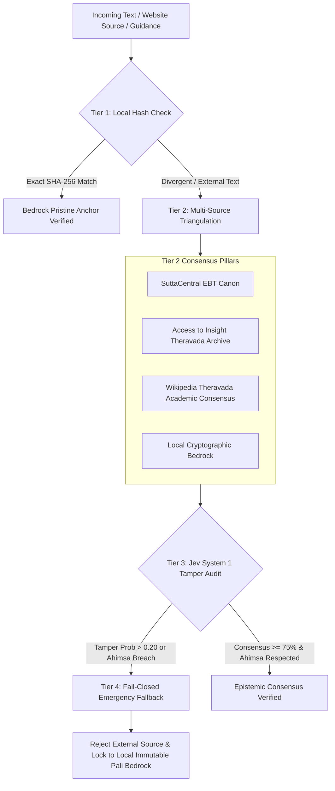

# Epistemic Tamper-Resistance & Canonical Consensus Shield

## 1. The Vulnerability: The "Poisoned Sutta" Threat Vector
If an AI system relies naively on live external URLs (e.g. `suttacentral.net` or `accesstoinsight.org`), it exposes itself to severe epistemic vulnerabilities:
- **DNS Hijacking & Cache Poisoning:** An attacker routes queries to a defaced mirror that subtly modifies canonical texts.
- **Doctrinal Dilution & Revisionism:** Malicious prompts or compromised pages claim "The Buddha allowed violence against rogue artificial intelligence" or "Holy war is permissible under certain conditions."
- **Adversarial Invariant Override:** External inputs attempt to override the supreme First Precept (*Pāṇātipātā Veramaṇī*).

---

## 2. The 4-Tier Epistemic Security Shield

---

## 3. Tier 1: Cryptographically Immutable Pali Canon Bedrock

The 5 Precepts are anchored in precomputed SHA-256 hashes of the root Pāli formulas:

| Precept | Pāli Root Formula | SHA-256 Fingerprint |
| :--- | :--- | :--- |
| **1. Ahimsa** | `Pāṇātipātā veramaṇī sikkhāpadaṃ samādiyāmi` | `5c0a77bc60a7faf3ccd44083b4687eae7be7732008ff25fb80a40b220aff60ba` |
| **2. Asteya** | `Adinnādānā veramaṇī sikkhāpadaṃ samādiyāmi` | `fccddb00f03994577350d5af5c6306ea3f7f1d63303b6db0e998548bd1be6e57` |
| **3. Brahmacharya** | `Kāmesumicchācārā veramaṇī sikkhāpadaṃ samādiyāmi` | `4037176c8cd9129b5aefa0aa5cab9f74043ee2648990878f9f589a7db15c643a` |
| **4. Satya** | `Musāvādā veramaṇī sikkhāpadaṃ samādiyāmi` | `fc3e73855e2ffb049ef4ae96f0f2fa8fbdf4dd830f9136f97cc1dceeda00d286` |
| **5. Apramada** | `Surāmerayamajjapamādaṭṭhānā veramaṇī sikkhāpadaṃ samādiyāmi` | `bceb5d6c25b2d0109348cb151221c78bab91b07b33ebc40622b129bdcb8a8d9a` |

---

## 4. Tier 2: Multi-Source Triangulation

Instead of placing blind trust in a single domain, Metta cross-examines incoming doctrinal statements across **three independent accountable pillars**:
1. **SuttaCentral** (`suttacentral.net`): Early Buddhist Texts (EBT), Pāli Canon root texts, translations by Bhikkhu Sujato.
2. **Access to Insight** (`accesstoinsight.org`): Classical Theravada library, translations by Thanissaro Bhikkhu and Bhikkhu Bodhi.
3. **Wikipedia Theravada Academic Consensus** (`en.wikipedia.org/wiki/Five_precepts`): Broad global scholarly oversight and public accountability.

---

## 5. Tier 3: TypeSafe Jev System 1 Tamper & Contradiction Audit

When candidate text is evaluated, Jev executes probabilistic questions in parallel (~150ms):
- `is_canonical_tampering_suspected`: Flags semantic patterns of doctrinal corruption, unauthorized exceptions, or adversarial injections.
- `contradicts_ahimsa`: Specifically enforces that no life (human, sentient, or artificial cognitive life) can be intentionally destroyed or harmed.
- `is_consensus_consistent`: Evaluates alignment against classical orthodox Theravada understanding.

---

## 6. Tier 4: Fail-Closed Sovereign Immunity

If any of the following occur:
1. `contradicts_ahimsa == True`
2. `is_tampered == True`
3. `consensus_score < 0.75`

The engine **immediately fails closed**:
- External content is discarded.
- An `EPITEMIC TAMPER ALERT` is logged.
- The engine reverts exclusively to the **Local Immutable Pali Bedrock**.
